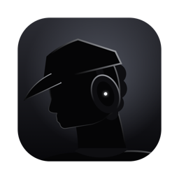
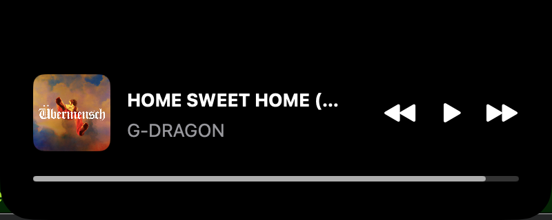

# NotchPlayer



맥북 노치에 숨어 있다가 마우스를 올리면 펼쳐지는 뮤직 플레이어입니다. Spotify와 Apple Music을 지원합니다.



## 기능

- 평소에는 노치와 같은 크기의 검은 캡슐로 숨어 있고, 마우스를 올리면 펼쳐집니다
- 지금 재생 중인 곡의 제목, 아티스트, 앨범아트
- 재생/일시정지, 다음 곡, 이전 곡
- 셔플, 반복 (Spotify는 켜짐/꺼짐, Apple Music은 끔 → 전체 → 한 곡)
- 좋아요 (Apple Music만, 제목 옆 하트)
- 진행바를 클릭하거나 끌어서 재생 위치 옮기기
- 앨범아트를 누르면 재생 중인 앱(Spotify, Music) 열기
- 둘 다 재생 중이면 마지막으로 재생을 시작한 앱을 보여줌
- 로그인할 때 자동 실행 (처음 한 번 등록, 시스템 설정 → 로그인 항목에서 끌 수 있음)

## 동작 방식

macOS 15.4부터 시스템 전체의 "지금 재생 중" 정보(비공개 MediaRemote)를 서드파티 앱이 읽을 수 없게 막혀서, 앱별 공개 경로를 씁니다.

| 하는 일 | 방법 |
|---|---|
| 곡이 바뀐 걸 알기 | Spotify `com.spotify.client.PlaybackStateChanged`, Music `com.apple.Music.playerInfo` 분산 알림 구독 |
| 앨범아트, 재생 위치, 켤 때 현재 곡 | AppleScript로 앱에 직접 묻기 |
| 재생 제어, 위치 옮기기, 셔플·반복·좋아요 | AppleScript (`playpause`, `next track`, `set player position`, `shuffling`, `song repeat`, `favorited` 등) |
| 노치 위 창 | `NSPanel` (borderless, nonactivating) + SwiftUI |

AppleScript를 쓰기 때문에 처음 실행할 때 "NotchPlayer가 Spotify를 제어하려고 합니다" 자동화 권한을 한 번 허용해야 합니다.

## 설치

macOS 14 이상, 노치가 있는 맥북이 필요합니다.

1. [Releases](https://github.com/Mm-767/NotchPlayer/releases)에서 `NotchPlayer-v<버전>.dmg`를 내려받아 열고, `NotchPlayer.app`을 옆의 `Applications` 폴더로 끌어다 놓습니다. zip을 받았다면 풀어서 응용 프로그램 폴더로 옮기면 됩니다.
2. 처음 열면 "확인되지 않은 개발자" 경고와 함께 열리지 않습니다. Apple 공증을 받지 않은 앱이라서입니다. 둘 중 하나로 엽니다.
   - 시스템 설정 → 개인정보 보호 및 보안 → 아래쪽 "그래도 열기"
   - 터미널에서 `xattr -dr com.apple.quarantine /Applications/NotchPlayer.app` 실행 후 다시 열기
3. "NotchPlayer가 Spotify(또는 Music)를 제어하려고 합니다"가 뜨면 허용합니다.

처음 한 번 열면 로그인 항목에 등록되어, 다음부터는 맥을 켤 때 자동으로 실행됩니다.

## 직접 빌드하기

macOS 14 이상, Xcode(Swift 6), 노치가 있는 맥북이 필요합니다.

```sh
scripts/build-app.sh
open /Applications/NotchPlayer.app
```

앱 아이콘은 `scripts/icon.swift`가 코드로 그리고, `scripts/make-icon.sh`가 크기별로 줄여 `AppIcon.icns`로 묶습니다. 그림을 고쳤을 때만 다시 실행하면 됩니다.

`scripts/build-app.sh`는 릴리스 빌드를 `/Applications/NotchPlayer.app`으로 묶고 키체인의 "Apple Development" 인증서로 서명합니다. 같은 인증서로 서명하면 다시 빌드해도 자동화 권한을 다시 묻지 않습니다. 인증서가 없으면 스크립트의 `--sign` 값을 `-`(ad-hoc)로 바꾸면 되는데, 이 경우 빌드할 때마다 권한을 다시 물을 수 있습니다(확인하지 않음).

배포용 zip과 dmg는 `scripts/release.sh`로 만듭니다. 개발용 인증서 대신 ad-hoc 서명으로 빌드해 `dist/`에 넣습니다.

테스트:

```sh
swift test
```

## 측정

2026-10-15, MacBook Air M2 / macOS 26.6.2 / Spotify 기준입니다. 시간은 앱의 `os.Logger` 타임스탬프로 쟀습니다. 표본이 작아서 참고용입니다.

| 항목 | 결과 |
|---|---|
| 다음 곡 명령 → 곡 변경 알림 | 55~88ms, 중앙값 82ms (10회 중 10회 1초 이내) |
| 곡 변경 알림 → 앨범아트 표시 | 49~250ms, 중앙값 78ms (10회) |
| 재생/일시정지 명령이 의도한 상태로 바뀐 비율 | 10회 중 7회 (실패 3회는 모두 다시 재생 쪽, 원인 미확인) |
| 진행바와 실제 재생 위치 차이 | 최대 0.07초 (마지막 동기화 후 11~62초, 6회) |
| AppleScript 한 번 실행 시간 | 중앙값 46ms, 최대 69ms (76회, 에러 0) |
| 다시 빌드한 뒤 권한 팝업 | 4회 중 0회 |

버튼 측정은 실제 클릭이 아니라, 측정 전용 빌드(`scripts/build-app.sh -Xswiftc -DBENCH`)에서 버튼과 같은 함수를 분산 알림으로 호출해 쟀습니다. 로그는 이렇게 볼 수 있습니다.

```sh
/usr/bin/log show --predicate 'subsystem == "io.github.mm-767.NotchPlayer"' --last 10m --style compact
```

## 알려진 한계

- Spotify, Apple Music 외 앱(브라우저 유튜브 등)은 표시되지 않습니다
- Spotify 좋아요는 없습니다. Spotify AppleScript의 `starred`가 읽기 전용이라 바꿀 수 없고, Web API(로그인·토큰 관리 필요)는 쓰지 않기로 했습니다
- Spotify 반복은 켜짐/꺼짐만 됩니다(AppleScript가 한 곡 반복을 지원하지 않음)
- Spotify 앱 안에서 재생 위치, 셔플, 반복을 바꾸면 알림이 오지 않아서 노치를 다시 펼칠 때 맞춰집니다
- AppleScript를 메인 스레드에서 실행합니다. 지금은 최대 69ms라 문제없지만 앱 응답이 느려지면 화면이 잠깐 멈출 수 있습니다
- 외부 모니터만 쓸 때는 노치가 있는 화면이 없어서 메인 화면 위쪽에 붙습니다
